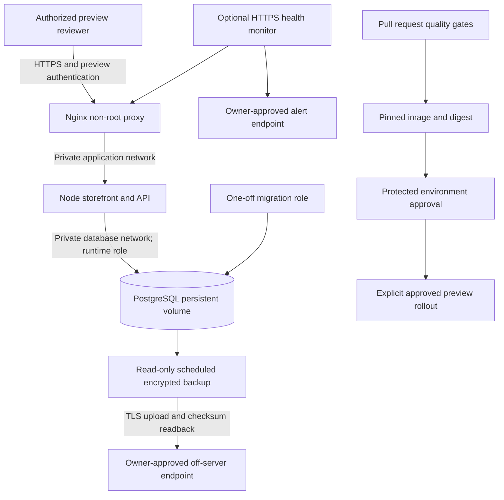

# Deployment architecture

The [implemented application architecture](../ARCHITECTURE.md) remains Node24 ES modules, vanilla same-origin UI and PostgreSQL16. Deployment adds a private Compose topology without rewriting the application.

Only Nginx's HTTPS listener is published, loopback by default. Database and app publish no ports. Only the proxy joins a separate ingress bridge so Docker can publish its HTTPS listener. Application/database networks are internal; optional backup egress is separate. No Redis is required: PostgreSQL supplies shared state, throttling, locks and idempotency. No local LLM or cloud resources are started.

The app and proxy run as UID1000, drop capabilities, use read-only roots and bounded tmpfs. PostgreSQL follows its official initialization model; app, migrator and backup logins are separate. Migration and initialization credentials never reach the running app. Explicit optional profiles prevent starting all operations by default.

The provided Compose file is an internal preview, not a production override. Basic authentication restricts preview access; app cookie roles/MFA still enforce sensitive APIs. Self-signed TLS fixtures prove local trust validation, not a publicly valid certificate. An owner-installed valid certificate replaces the fixture before public review.
